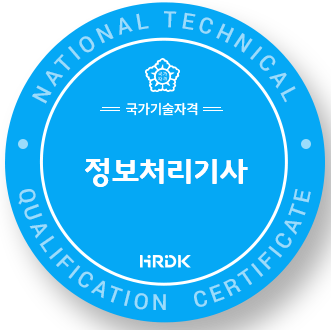

## Yeonseung Jeong
Cloud Security & DevSecOps

### Tech Stack

### Certifications

### Latest Blog Posts
<!-- BLOG-POST-LIST:START -->
- [47. 이미지 &amp; 코드 무결성 : AWS Signer, EC2 Image Builder 골든 AMI 파이프라인](https://itcase.tistory.com/entry/47-%EC%9D%B4%EB%AF%B8%EC%A7%80-%EC%BD%94%EB%93%9C-%EB%AC%B4%EA%B2%B0%EC%84%B1-AWS-Signer-EC2-Image-Builder-%EA%B3%A8%EB%93%A0-AMI-%ED%8C%8C%EC%9D%B4%ED%94%84%EB%9D%BC%EC%9D%B8)
- [46. Lambda 보안 : 실행 역할, VPC 배치, Function URL 인증](https://itcase.tistory.com/entry/46-Lambda-%EB%B3%B4%EC%95%88-%EC%8B%A4%ED%96%89-%EC%97%AD%ED%95%A0-VPC-%EB%B0%B0%EC%B9%98-Function-URL-%EC%9D%B8%EC%A6%9D)
- [45. 컨테이너 보안 : ECR 이미지 스캔, ECS Secret 관리, EKS 보안 모델](https://itcase.tistory.com/entry/45-%EC%BB%A8%ED%85%8C%EC%9D%B4%EB%84%88-%EB%B3%B4%EC%95%88-ECR-%EC%9D%B4%EB%AF%B8%EC%A7%80-%EC%8A%A4%EC%BA%94-ECS-Secret-%EA%B4%80%EB%A6%AC-EKS-%EB%B3%B4%EC%95%88-%EB%AA%A8%EB%8D%B8)
- [44. AWS RAM &amp; Service Catalog : 안전한 교차 계정 공유와 표준화된 프로비저닝](https://itcase.tistory.com/entry/44-AWS-RAM-Service-Catalog-%EC%95%88%EC%A0%84%ED%95%9C-%EA%B5%90%EC%B0%A8-%EA%B3%84%EC%A0%95-%EA%B3%B5%EC%9C%A0%EC%99%80-%ED%91%9C%EC%A4%80%ED%99%94%EB%90%9C-%ED%94%84%EB%A1%9C%EB%B9%84%EC%A0%80%EB%8B%9D)
- [43. CloudFormation 보안 : Service Role, Stack Policy, Drift, CloudFormation Guard](https://itcase.tistory.com/entry/43-CloudFormation-%EB%B3%B4%EC%95%88-Service-Role-Stack-Policy-Drift-CloudFormation-Guard)
<!-- BLOG-POST-LIST:END -->

---

